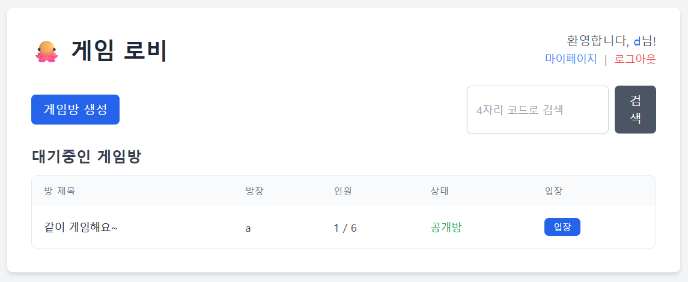
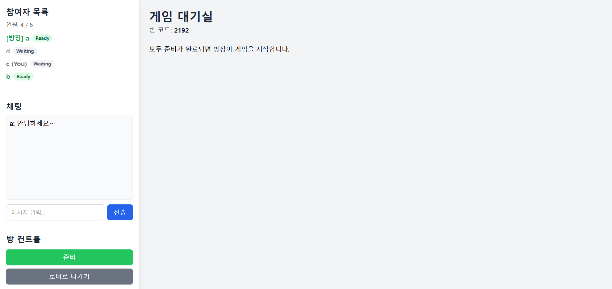
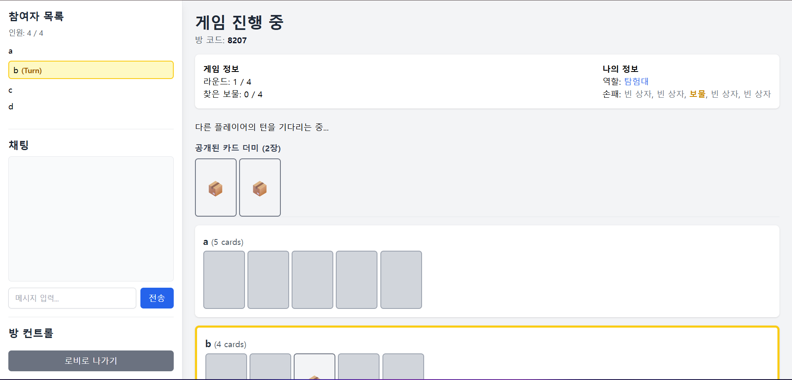

> 전환 전 Spring Boot 구현의 참고 문서입니다. 새 무료 운영 구조는 루트 README와 MIGRATION.md를 확인하세요.

# 노터치 크라켄 (No-Touch Kraken)

탐험대와 스켈레톤이 정체를 숨긴 채 보물과 크라켄을 찾는 **4~6인 실시간 웹 보드게임**입니다. Spring Boot 서버가 인증, 방 관리, 게임 진행을 담당하고, Thymeleaf 화면과 STOMP 메시지로 플레이어의 상태를 동기화합니다.

## 주요 기능

- **로그인·계정 관리**: Google OAuth2 로그인, 최초 닉네임 등록, 닉네임 변경, 회원 탈퇴
- **로비**: 대기 중인 방 조회, 4자리 코드 검색, 방 생성·입장, 비밀번호가 있는 방 지원
- **대기실**: 참여자·준비 상태 동기화, 채팅, 방장의 인원 변경·강퇴·게임 시작
- **게임**: 무작위 역할·카드 배정, 턴별 카드 공개, 라운드 전환, 승패 판정과 결과 표시
- **재진입**: 로그인 세션과 참여 정보가 유지된 경우 기존 방으로 이동하고 게임 상태 재요청

> 현재 기본 로그인은 Google OAuth2입니다. 게스트 로그인 서비스와 화면도 남아 있지만, 비로그인 사용자의 게스트 로그인 경로와 화면 연결은 활성화되어 있지 않습니다.

## 화면

### 로비



### 대기실



### 게임 진행



## 기술 스택

| 구분 | 사용 기술 |
| --- | --- |
| 언어·빌드 | Java 17, Gradle Wrapper 8.14.3 |
| 서버 | Spring Boot 3.5.7, Spring MVC |
| 인증 | Spring Security, OAuth2 Client (Google), HTTP 세션 |
| 실시간 통신 | Spring WebSocket, STOMP, SockJS, 내장 Simple Broker |
| 데이터 | Spring Data JPA, H2·MySQL 드라이버 |
| 화면 | Thymeleaf, JavaScript, Tailwind CSS CDN |
| 개발·테스트 | Lombok, Spring Boot DevTools, JUnit Jupiter, Spring Security Test |

별도 프런트엔드 빌드 과정은 없습니다. Tailwind CSS, SockJS, STOMP 클라이언트를 CDN에서 불러오므로 화면 사용 시 외부 네트워크 연결이 필요합니다.

## 로컬 실행

### 1. 준비 및 클론

JDK 17과 Git이 필요합니다. Gradle은 저장소의 Wrapper를 사용하며, 최초 실행 시 배포 파일과 의존성을 내려받습니다.

```bash
git clone https://github.com/OhWootaek/kraken.git
cd kraken
java -version
```

아래 명령은 macOS/Linux 기준입니다. 저장소의 `gradlew`에 실행 권한이 없어도 실행할 수 있도록 `bash gradlew`를 사용합니다. Windows에서는 `gradlew.bat`로 대체하세요.

### 2. 로컬 설정 파일 생성

저장소에는 `application.properties`와 프로필별 설정 파일이 포함되어 있지 않습니다. `src/main/resources/application-local.properties`를 생성하고 다음 내용을 입력합니다.

```properties
# 개발용 인메모리 DB: 애플리케이션 종료 시 데이터가 사라집니다.
spring.datasource.url=jdbc:h2:mem:kraken;DB_CLOSE_DELAY=-1;DB_CLOSE_ON_EXIT=FALSE
spring.datasource.driver-class-name=org.h2.Driver
spring.datasource.username=sa
spring.datasource.password=
spring.jpa.hibernate.ddl-auto=update

# Google OAuth2
spring.security.oauth2.client.registration.google.client-id=${GOOGLE_CLIENT_ID}
spring.security.oauth2.client.registration.google.client-secret=${GOOGLE_CLIENT_SECRET}
spring.security.oauth2.client.registration.google.scope=profile,email
```

`application-local.properties`는 `.gitignore`에 등록되어 있습니다. 위의 OAuth2 값은 다음 단계에서 환경 변수로 전달합니다. `.env` 파일을 자동으로 읽는 구성은 포함되어 있지 않습니다.

### 3. Google OAuth2 설정

Google Cloud Console에서 웹 애플리케이션용 OAuth 클라이언트를 준비하고, 승인된 리디렉션 URI에 다음 주소를 등록합니다.

```text
http://localhost:8080/login/oauth2/code/google
```

실행할 터미널에 발급받은 값을 설정합니다.

```bash
export GOOGLE_CLIENT_ID='발급받은-client-id'
export GOOGLE_CLIENT_SECRET='발급받은-client-secret'
```

현재 `SecurityConfig`는 OAuth2 로그인을 사용하므로 클라이언트 등록 설정이 필요합니다. 게스트 로그인 코드가 있다는 이유만으로 이 설정을 생략할 수는 없습니다.

### 4. 서버 시작

```bash
bash gradlew bootRun --args='--spring.profiles.active=local'
```

[로컬 로그인 화면](http://localhost:8080)에 접속하여 Google로 로그인하고 닉네임을 등록합니다. 로그인 후 로비에서 방을 생성하거나 방 코드로 입장할 수 있습니다.

### 5. 게임 시작

1. 방 생성 시 정원을 4·5·6명 중 선택합니다. 비밀번호를 입력하면 비공개 방이 됩니다.
2. 다른 플레이어들이 로그인 후 같은 방에 입장합니다. 여러 계정을 한 기기에서 사용할 때는 서로 분리된 브라우저 프로필을 사용합니다.
3. 방장을 제외한 모든 플레이어가 준비를 완료합니다.
4. **현재 인원이 설정한 정원과 같고 최소 4명 이상**이면 방장이 게임을 시작할 수 있습니다.

## 게임 규칙

아래 내용은 `GameService`에 구현된 동작을 기준으로 합니다.

### 역할과 카드

- 역할은 **탐험대(`EXPLORER`)**와 **스켈레톤(`SKELETON`)**입니다.
- 4인 게임은 탐험대 3장·스켈레톤 2장 중 4장을, 5인 게임은 탐험대 4장·스켈레톤 2장 중 5장을 무작위로 배정합니다. 따라서 4·5인 게임의 팀별 인원은 고정되지 않습니다. 6인 게임은 탐험대 4명·스켈레톤 2명입니다.
- 최초 덱은 `인원수 × 5`장으로, 크라켄 1장, 인원수만큼의 보물, 나머지 빈 상자로 구성됩니다.
- 각 플레이어는 자신의 역할과 손패 구성을 확인합니다. 실제 선택 대상 카드는 별도로 섞이므로 자신의 카드 위치별 내용은 알 수 없습니다.

### 턴과 라운드

1. 첫 턴은 무작위로 정합니다.
2. 자기 턴에는 다른 플레이어의 미공개 카드 한 장을 선택합니다. 자신의 카드나 이미 공개된 카드는 선택할 수 없습니다.
3. 선택된 카드의 주인이 다음 턴을 받습니다.
4. 인원수만큼 카드가 공개되면 라운드가 끝납니다. 승패가 결정되지 않았다면 3초 후 남은 카드를 섞어 재분배합니다.
5. 총 4라운드이며, 라운드별 손패는 5장 → 4장 → 3장 → 2장입니다.

| 종료 조건 | 승리 팀 |
| --- | --- |
| 모든 보물을 발견 | 탐험대 |
| 크라켄 카드 공개 | 스켈레톤 |
| 4라운드 종료까지 보물을 모두 찾지 못함 | 스켈레톤 |

게임 종료 시 모든 플레이어의 역할과 결과를 공개하고, 참여 정보를 정리한 뒤 화면은 10초 후 로비로 이동합니다.

## 프로젝트 구조

```text
src/main/java/com/oh/kraken/
├── KrakenApplication.java
├── domain/
│   ├── user/       # 사용자 엔티티, 계정 관리, 게스트 로그인 코드
│   ├── room/       # 방·참여자 엔티티, HTTP API, 입퇴장·방장 관리
│   └── game/       # STOMP 컨트롤러, 게임 로직, 메모리 상태, DTO
└── global/
    ├── auth/       # OAuth2 사용자 처리·로그인 성공 핸들러
    ├── config/     # HTTP·WebSocket 보안, 메시지 브로커 설정
    ├── websocket/  # 로비·방·개인 메시지 전송
    └── PageController.java
src/main/resources/
├── templates/      # 로그인, 닉네임 등록, 마이페이지, 로비, 게임방
└── static/js/      # lobby.js, game-room.js
src/test/java/com/oh/kraken/
└── KrakenApplicationTests.java
```

### 데이터와 상태 관리

| 저장 위치 | 데이터 |
| --- | --- |
| `users` 테이블 | 이메일·닉네임(각각 유일), 권한, 로그인 제공자 |
| `game_rooms` 테이블 | 방 코드(유일), 제목, 비밀번호 해시, 정원, 상태, 방장 |
| `room_participants` 테이블 | 방·사용자 연결, 준비 상태, 입장 시각 |
| 서버 메모리 `activeGames` | 역할, 손패·카드 배치, 현재 턴, 라운드, 발견한 보물 |

`GameRoom`은 여러 참여자를 가지며, `RoomParticipant.user_id`는 유일하므로 한 사용자는 동시에 하나의 방에만 참여할 수 있습니다. 참여자 생명주기는 방의 `cascade`·`orphanRemoval`로 관리합니다. 방 비밀번호는 BCrypt로 해시합니다.

로비는 `/topic/lobby/update`의 갱신 알림을 받으면 HTTP로 방 목록을 다시 조회합니다. 대기실은 방 상태를 공용 토픽으로 전달하고, 인게임은 공통 상태와 개인 비밀 정보를 묶어 각 사용자의 전용 경로로 전달합니다.

## 주요 HTTP 경로

방 생성·입퇴장과 계정 변경은 JSON API가 아닌 **폼 전송 및 리디렉션** 방식입니다. 방 목록·검색 API는 JSON을 반환합니다. 게임 기능은 로그인한 사용자를 대상으로 합니다.

| 메서드 | 경로 | 용도 |
| --- | --- | --- |
| GET | `/login` | Google 로그인 화면 |
| GET | `/oauth2/authorization/google` | Google 로그인 시작 |
| GET / POST | `/register-username` | 최초 닉네임 등록 화면·처리 |
| GET | `/lobby` | 로비 화면·기존 방 재진입 |
| GET | `/api/rooms` | 대기 중인 방 목록 |
| GET | `/api/rooms/search?code=1234` | 방 코드 검색 |
| POST | `/room/create` | 방 생성: `title`, `password`, `maxPlayers` |
| POST | `/room/join` | 방 입장: `roomCode`, `password` |
| POST | `/room/leave` | 현재 방 퇴장 |
| GET | `/room/{roomCode}` | 게임방 화면 |
| GET | `/mypage` | 계정 관리 화면 |
| POST | `/mypage/update-username` | 닉네임 변경: `newUsername` |
| POST | `/mypage/delete` | 회원 탈퇴 |
| POST | `/logout` | 로그아웃 |

## 실시간 통신

SockJS 연결 엔드포인트는 `/ws-stomp`, 서버에 메시지를 보낼 때 사용하는 접두사는 `/app`입니다. WebSocket 연결에도 로그인 인증을 사용하며, 개인 메시지의 사용자 식별자는 이메일입니다.

### 클라이언트 → 서버

| STOMP 목적지 | 동작·페이로드 |
| --- | --- |
| `/app/room/{roomCode}/state` | 구독 시 현재 대기실 상태 1회 응답 (`@SubscribeMapping`) |
| `/app/room/{roomCode}/ready` | 준비 상태 토글 |
| `/app/room/{roomCode}/chat` | 채팅: `{"message":"안녕하세요"}` |
| `/app/room/{roomCode}/kick` | 방장 강퇴: `{"username":"닉네임"}` |
| `/app/room/{roomCode}/config/max-players` | 정원 변경: `{"maxPlayers":4}` |
| `/app/room/{roomCode}/start` | 게임 시작 |
| `/app/room/{roomCode}/select-card` | 카드 공개: `{"targetPlayerId":2,"selectedCardId":"카드 ID"}` |
| `/app/room/{roomCode}/request-game-state` | 재진입 시 개인 게임 상태 요청 |

### 서버 → 클라이언트 구독 경로

| 구독 경로 | 수신 내용 |
| --- | --- |
| `/topic/lobby/update` | 방 목록 재조회 알림 (`refresh`) |
| `/topic/room/{roomCode}/state` | 대기실 상태 |
| `/topic/room/{roomCode}/chat` | 채팅 메시지 |
| `/topic/room/{roomCode}/game-result` | 게임 결과 |
| `/user/topic/room/{roomCode}/game-state` | 개인별 게임 상태 (`commonState`, `myState`) |
| `/user/topic/room/errors` | 요청 처리 오류 |
| `/user/topic/room/action` | 강퇴 알림 |

## 빌드와 테스트

로컬 실행과 동일한 OAuth2 환경 변수 및 설정 파일을 준비한 뒤 실행합니다.

```bash
# 현재 테스트: Spring 애플리케이션 컨텍스트 로딩
SPRING_PROFILES_ACTIVE=local bash gradlew test

# 테스트를 포함한 빌드
SPRING_PROFILES_ACTIVE=local bash gradlew clean build

# 실행 가능한 JAR 생성
bash gradlew bootJar

# JAR로 로컬 서버 실행
java -jar build/libs/kraken-0.0.1-SNAPSHOT.jar --spring.profiles.active=local
```

현재 자동 테스트는 `contextLoads()` 한 개이며, 게임 규칙과 여러 사용자 간 실시간 동작을 검증하는 테스트는 포함되어 있지 않습니다.

## 배포 구성

MySQL 드라이버는 포함되어 있지만 운영 설정, 인프라 코드, 배포 자동화 파일은 저장소에 없습니다. MySQL을 사용할 경우 별도의 DB를 준비하고 `src/main/resources/application-prod.properties` 등으로 다음 설정을 제공합니다.

```properties
spring.datasource.url=${DB_URL}
spring.datasource.username=${DB_USERNAME}
spring.datasource.password=${DB_PASSWORD}
spring.datasource.driver-class-name=com.mysql.cj.jdbc.Driver
spring.jpa.hibernate.ddl-auto=validate

spring.security.oauth2.client.registration.google.client-id=${GOOGLE_CLIENT_ID}
spring.security.oauth2.client.registration.google.client-secret=${GOOGLE_CLIENT_SECRET}
spring.security.oauth2.client.registration.google.scope=profile,email
```

`DB_URL`은 `jdbc:mysql://호스트:3306/DB이름` 형식입니다. 이 예시는 `validate`를 사용하므로 엔티티에 맞는 테이블을 먼저 준비해야 합니다. 스키마 마이그레이션 도구·스크립트는 포함되어 있지 않습니다.

```bash
bash gradlew bootJar
java -jar build/libs/kraken-0.0.1-SNAPSHOT.jar --spring.profiles.active=prod
```

리버스 프록시를 사용할 경우 HTTP 요청과 `/ws-stomp`의 WebSocket·SockJS 통신을 모두 서버로 전달해야 합니다. 외부 접속 주소에 맞게 Google OAuth2 리디렉션 URI와 프록시 전달 헤더 처리도 설정해야 합니다.

## 현재 구현의 제약

- **게임 상태는 메모리에만 저장됩니다.** 서버를 재시작하면 진행 중인 게임이 복구되지 않으며, DB에 남은 방·참여 정보와 어긋날 수 있습니다. 내장 메시지 브로커를 사용하므로 여러 서버 사이의 게임 상태·메시지 공유도 구현되어 있지 않습니다.
- **재진입과 연결 끊김 처리는 다릅니다.** 기존 세션·참여 정보로 방에 다시 들어갈 수 있지만, 연결 끊김 감지에 따른 자동 퇴장·방장 위임은 구현되어 있지 않습니다. 방장 위임은 명시적 퇴장 등 참여 정보 정리 흐름에서 처리합니다.
- **게스트 로그인은 개발용 코드입니다.** 현재 기본 화면에서 사용할 수 없고, 서비스는 기존 닉네임을 입력하면 해당 사용자를 반환하므로 별도의 본인 확인 수단이 없습니다.
- **보안 설정은 추가 검토가 필요합니다.** 현재 HTTP·STOMP CSRF 검사를 비활성화하고 있으며, STOMP 목적지별 방 참여 권한 검증이 모든 핸들러에 적용되어 있지는 않습니다.

이 README는 저장소 코드를 기준으로 작성했습니다. 작성 환경에 Java 런타임이 없어 `bash gradlew test`는 실행을 완료하지 못했으며, 서버 기동·실제 Google 로그인·다인 플레이는 검증하지 못했습니다.
